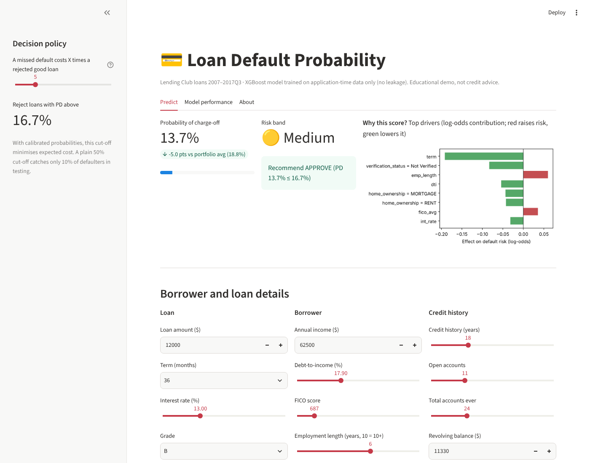

# Loan Default Probability: Lending Club

Predicts the probability that a loan is **charged off** (1) vs fully paid (0) from application-time
data, compares five ML frameworks, and serves the best model through a Streamlit web app.



## What's in this repo

| File | Purpose |
|---|---|
| `Loan_Default_Probability.ipynb` | Colab notebook: EDA, XGBoost / Keras / fastai / TabNet / PyTorch Lightning, comparison, SHAP, calibration, ensemble, cost-sensitive threshold, auto-written report |
| `app.py` | Streamlit UI: enter a borrower, get PD, risk band, approve/reject recommendation and per-prediction explanation |
| `train.py` | Trains the XGBoost model and writes `model/` (downloads the dataset automatically) |
| `loan_features.py` | Feature engineering shared by training and the app |
| `model/` | Trained model (`xgb_model.json`) and metadata (`meta.json`) |

## Run the app

```bash
pip install -r requirements.txt
python -m streamlit run app.py
```

To retrain from scratch (about 10 seconds): `python train.py`

## Results (XGBoost, 17,228 held-out loans)

ROC-AUC 0.734 · PR-AUC 0.390 · RMSE 0.368 · MAE 0.272 · R² 0.114 · LogLoss 0.428

The probabilities are well calibrated. A plain 50% cut-off catches only about 10% of defaulters, so the
app uses a **cost-based threshold** (reject if PD > cost_FP / (cost_FP + cost_FN)). At a 5:1 cost ratio
this cuts expected cost per loan by about a third versus the 50% cut-off.

## Design choices

- **Classification, not regression**: the target is binary, so the model outputs a probability.
  RMSE / MAE / R² are computed on that probability.
- **No leakage**: only application-time fields are used; `total_pymnt`, `recoveries`, `last_pymnt_d` etc. are excluded.
- **No class re-weighting / SMOTE**: keeps probabilities calibrated.
- **Explainability**: each score is explained with XGBoost's built-in SHAP contributions.
- **Lightning Flash** is archived, so the notebook uses PyTorch Lightning directly.

## Five-framework comparison

Run the notebook to the end on Colab. It exports `model_comparison.csv`; put that file in the repo root
and the app's *Model performance* tab will show the full comparison table.

## Data

[LoansData_sample.csv.gz](https://github.com/tiwvis/MLBD-Projects/blob/main/data_sets/LoansData_sample.csv.gz):
100,000 Lending Club loans, of which 86,138 are closed (Fully Paid / Charged Off).

*Educational project. Not a real underwriting tool.*
